# Activity Diagram — KursusIO

> Dokumen ini disusun dari **audit statis** terhadap `routes/web.php`, controller, service, model, migration, job, command, dan konfigurasi. Referensi fitur: [README.md](../README.md) dan [PRD.md](./PRD.md). Use case terkait: [use-case-diagram.md](./use-case-diagram.md).

Dokumen ini memuat **activity diagram** seluruh alur fitur KursusIO dalam Mermaid. Fokusnya bukan hanya happy path, tetapi juga cabang keputusan, kegagalan, dan proses asinkron yang benar-benar ada di kode.

- **Tanggal audit:** 16 November 2026
- **Sumber utama:** `routes/web.php`, `app/Http/Controllers`, `app/Services`, `app/Jobs`, `app/Console/Commands`, `routes/console.php`
- **Sifat audit:** penelusuran statis route → controller → service/model. Bukan hasil uji runtime atau uji beban.

---

## 1. Cara Membaca Diagram

Mermaid tidak memiliki notasi UML activity diagram native, sehingga digunakan `flowchart TD` dengan konvensi berikut:

| Simbol | Arti |
| --- | --- |
| `(["Mulai"])` / `(["Selesai"])` | Start / end activity |
| `["Aksi"]` | Activity atau proses |
| `{"Keputusan?"}` | Decision node |
| `-->|"Ya"|` | Alur normal |
| `-.->|"Job"|` | Proses asinkron (queue / job / webhook) |
| Teks *miring* | Catatan audit atau perilaku yang perlu diperhatikan |

**Aturan penulisan:** semua label yang memiliki karakter khusus (`()`, `/`, `:`, `?`) ditulis dalam tanda kutip. Node akhir memakai `Selesai`, bukan `end`, karena `end` adalah kata kunci Mermaid.

### Status pada matriks audit

| Status | Arti |
| --- | --- |
| ✅ | Alur terimplementasi dan konsisten dengan dokumen fitur |
| ⚠️ | Terimplementasi, tetapi ada perilaku yang perlu dicatat |
| ❌ | Belum ada alur/endpoint eksplisit |

---

## 2. Aktor, Boundary, dan Otorisasi

| Aktor / Boundary | Peran | Titik masuk utama |
| --- | --- | --- |
| Guest | Melihat landing, katalog, detail kursus, verifikasi sertifikat, halaman legal | `/`, `/course`, `/course/{slug}`, `/certificate/{number}` |
| Student | Enroll, checkout, belajar, quiz, sertifikat, review, komentar, AI chat | `/student/*`, `/course/{slug}/enroll`, `/ai/*` |
| Instructor | Menyusun kursus, mengelola quiz, payout account, WhatsApp, AI tools | `/instructor/*` |
| Admin | Approval kursus, order/refund, payout, moderasi, user, settings, integrasi | `/admin/*` |
| Midtrans | Gateway pembayaran dan sumber webhook | `POST /payments/midtrans/webhook` |
| WhatsApp Provider | Pengirim notifikasi dan pengirim webhook status | `GET/POST /webhooks/whatsapp/{provider}` |
| Python ML Service | Recommendation engine eksternal (FastAPI) | `recommendation-service/` |
| Scheduler / Queue | Expiry order, retry job, prune failed jobs, ML command | `routes/console.php`, `app/Jobs` |

### Middleware dan gate yang membatasi alur

| Boundary | Mekanisme |
| --- | --- |
| Area student/instructor/admin | Middleware `auth` + `role:student` / `role:instructor` / `role:admin` |
| Struktur kursus | Middleware `can:update,course` pada route module/material/content/quiz/resource |
| Publikasi kursus | `Gate::authorize('publish', $course)` — admin-only |
| Pengaturan & integrasi | Policy `manage-settings` |
| AI chat | `auth` + `role:student,instructor`; rate limit `10/menit` untuk kirim pesan |
| WhatsApp webhook | Throttle `whatsapp-webhooks` (120/menit) + verifikasi signature/provider |
| Midtrans webhook | Verifikasi signature SHA-512, merchant ID, dan amount |

---

## 3. Peta Alur End-to-End

Diagram ini adalah peta besar perjalanan student dari discovery sampai sertifikat. Detail setiap tahap ada pada bagian berikutnya.

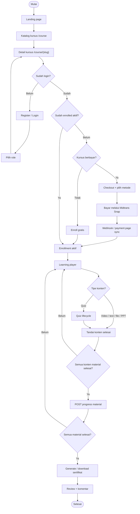

### Alur operasional di luar perjalanan student

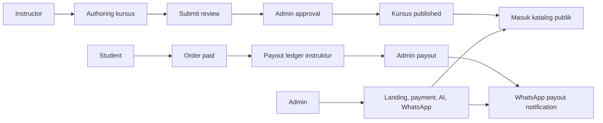

---

## 4. Registrasi, Login, Verifikasi, dan Reset Password

**Bukti:** `AuthControllers`, `RoleController`, route group `guest`, `auth`, dan `role`.

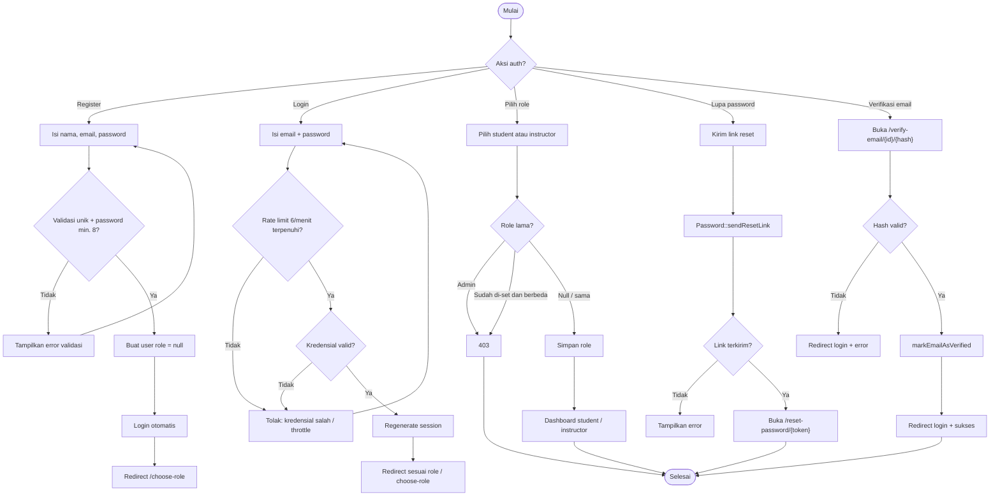

**Catatan audit**

- Registrasi selalu membuat `role = null`; student/instructor dipilih sekali pada onboarding.
- Admin tidak boleh memilih role melalui `/choose-role`.
- Route kirim ulang verifikasi memakai middleware `auth`; belum ada middleware `verified` yang memaksa verifikasi pada area belajar.
- `POST /reset-password` belum memiliki throttle eksplisit, berbeda dari `forgot-password` dan `login` yang memakai `throttle:6,1`.

---

## 5. Landing, Katalog, Detail Kursus, dan Verifikasi Sertifikat

**Bukti:** `LandingController`, closure route `/course`, `CourseController@show`, `RecommendationService`, `ReviewService`, `CommentService`, `CertificateController@verify`.

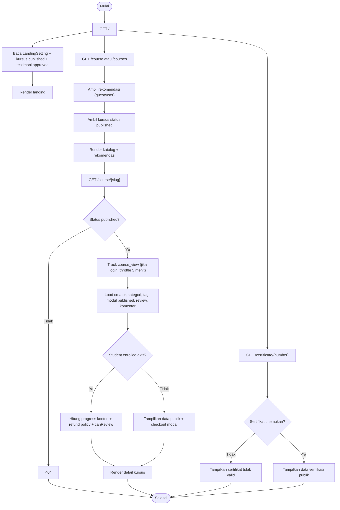

**Catatan audit**

- Guest hanya mendapat rekomendasi populer; rekomendasi personal membutuhkan user dan event.
- Halaman detail memakai **content progress** untuk progress bar, sedangkan `isCompleted()` memakai **material progress**. Lihat temuan §34.

---

## 6. Enroll Kursus Gratis

**Bukti:** `EnrollmentController@store`, `EnrollmentService::enroll`, `dispatchWhatsAppNotification`, `EventTrackingService`.

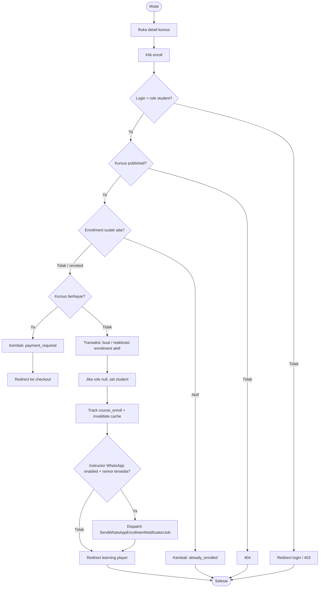

**Catatan audit**

- Enrollment berbayar yang `revoked`/`expired` tidak diaktifkan ulang lewat endpoint enroll; student harus checkout lagi.
- Enrollment gratis yang pernah ada akan diubah kembali menjadi `active`, bukan membuat baris baru.

---

## 7. Checkout Kursus Berbayar

**Bukti:** `CheckoutController`, `PaymentService::createOrder`, `resolvePendingOrder`, `MidtransPaymentGateway`, `PaymentSettings`.

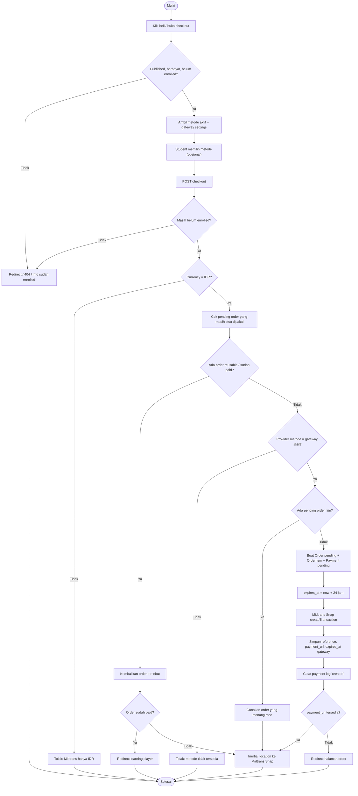

**Catatan audit**

- `CheckoutController` menolak course gratis (`404`); enrollment gratis memakai endpoint enroll pada §6. `PaymentService::createOrder()` tetap memiliki cabang defensif yang mengembalikan `Enrollment` jika dipanggil internal untuk course gratis.
- Order pending yang sudah tidak valid di gateway diperiksa ulang sebelum membuat transaksi baru, sehingga retry checkout tidak mengarah ke Snap page yang mati.
- `POST /student/courses/{slug}/checkout` tidak memiliki route name eksplisit, tetapi dipakai oleh frontend.
- Midtrans Snap tetap menjadi tempat pemilihan channel final (QRIS/VA/GoPay/Credit Card).

---

## 8. Halaman Pembayaran dan Sinkronisasi Status

**Bukti:** `PaymentController@show`, `MidtransPaymentGateway::verify`, `PaymentService::markPaid`, `markUnpaid`, `handleChargeback`.

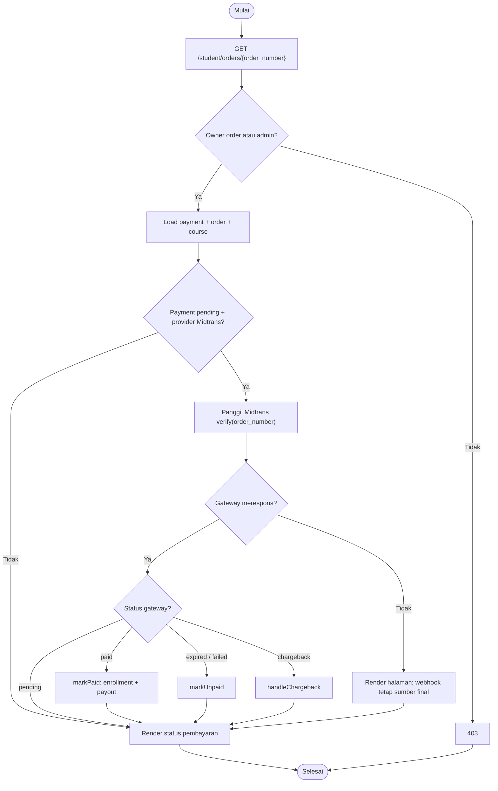

---

## 9. Webhook Midtrans

**Bukti:** `PaymentWebhookController@midtrans`, `MidtransPaymentGateway::mapStatus`, `transactionFields`.

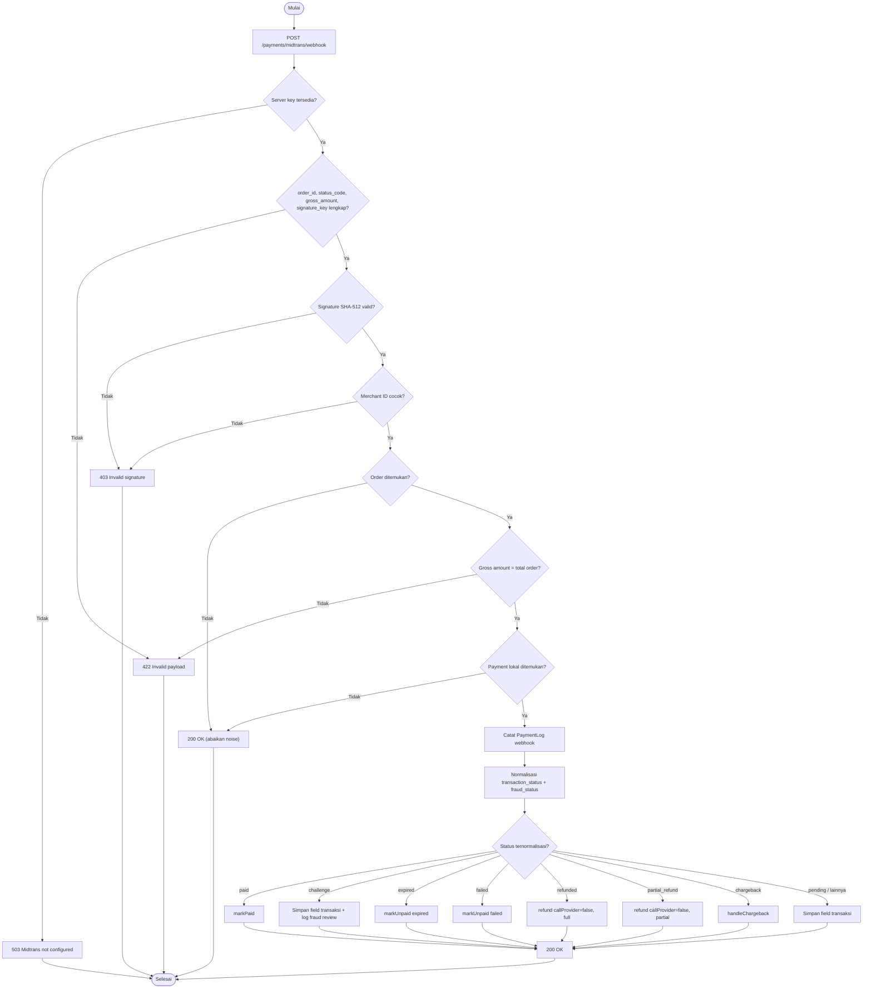

**Catatan audit**

- Webhook yang gagal diproses mengembalikan `500` agar Midtrans melakukan retry.
- `challenge` tidak mengubah status order; hanya menyimpan data dan mencatat log fraud review.
- Order yang tidak dikenal tetap dijawab `200 OK` agar Midtrans berhenti retry.

---

## 10. Efek Pembayaran `paid`: Enrollment dan Payout Ledger

**Bukti:** `PaymentService::markPaid`, `EnrollmentService::activate`, `recordPayouts`, `PaymentSettings`.

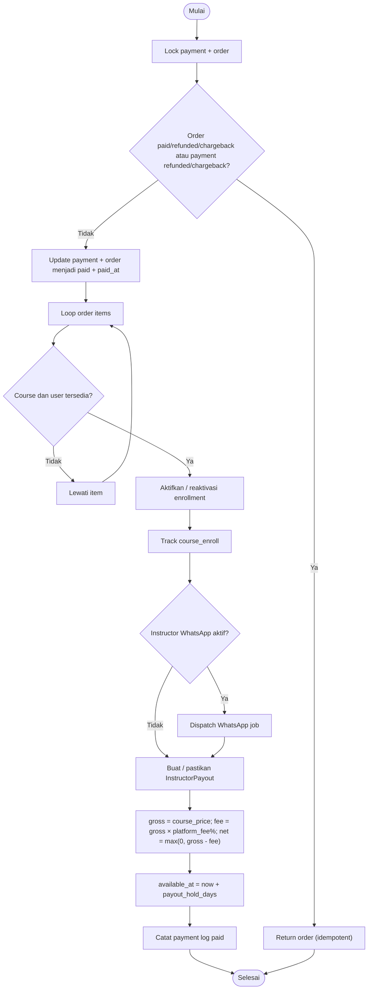

**Catatan audit**

- Ledger payout bersifat audit trail; transfer bank **tidak** dilakukan otomatis.
- Payout hanya dibuat jika course masih ada dan memiliki `creator_id`.
- `markPaid` juga dipanggil dari halaman pembayaran dan admin “mark paid”, bukan hanya webhook.

---

## 11. Refund Manual dan Chargeback

**Bukti:** `OrderController@refund`, `PaymentService::refund`, `handleChargeback`, `applyRefundToPayment`, `PaymentWebhookController::handleRefund`.

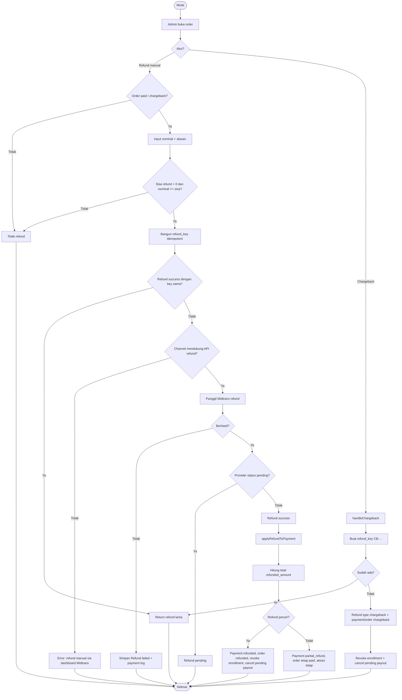

**Catatan audit**

- Refund penuh mencabut akses; refund parsial **tidak** mencabut akses dan order tetap `paid`.
- Chargeback selalu mencabut akses, termasuk chargeback parsial.
- Tidak ada endpoint pengajuan refund dari sisi student. Kebijakan refund hanya ditampilkan informatif; refund diinisiasi admin atau webhook.
- Refund dari webhook memakai `callProvider=false` agar tidak memanggil Midtrans dua kali.

---

## 12. Payout Instruktur

**Bukti:** `PayoutController`, `InstructorPayout`, `SendPayoutPaidNotificationJob`, `PaymentSettings`, `InstructorSettingsController@updatePayout`.

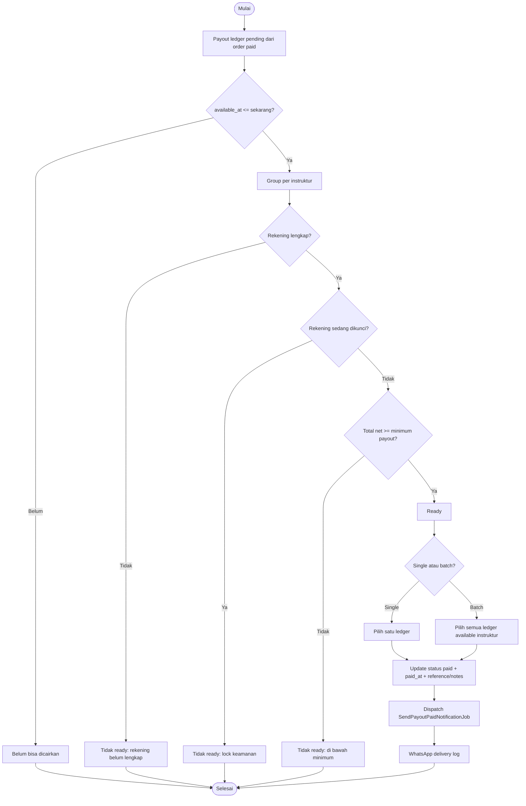

**Aturan payout yang terverifikasi**

| Aturan | Default | Sumber |
| --- | --- | --- |
| Platform fee | 20% | `PaymentSettings::platformFeePercent()` |
| Hold period | 7 hari | `PaymentSettings::payoutHoldDays()` |
| Minimum payout | Rp100.000 | `PaymentSettings::payoutMinimum()` |
| Account lock setelah ubah rekening | 24 jam | `PaymentSettings::payoutAccountLockHours()` |
| Perubahan rekening | Wajib password (setelah setup pertama) | `InstructorSettingsController@updatePayout` |
| Audit perubahan rekening | `PayoutAccountAudit` | idem |

**Catatan audit**

- Setup rekening pertama tidak memicu lock; lock hanya berlaku saat rekening **diubah** setelah lengkap.
- Batch payout mengunci baris ledger dengan `lockForUpdate` dan menghitung ulang kesiapan.
- CSV payout berisi rekap per instruktur, bukan detail tiap ledger.

---

## 13. Learning Player dan Progress

**Bukti:** `EnrollmentController@show`, `markProgress`, `markContentProgress`, `EnrollmentService::learningData`, `markContentProgress`, `markProgress`, `EventTrackingService`.

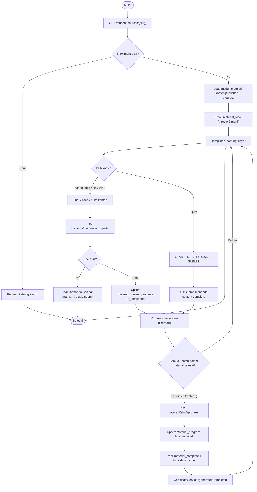

**Dua sistem progress yang hidup berdampingan**

| Sistem | Tabel | Dipakai oleh |
| --- | --- | --- |
| Content progress | `material_content_progress` | Progress bar halaman detail kursus, learning player, penyelesaian konten |
| Material progress | `material_progress` | `isCompleted()`, kelulusan review, sertifikat, akses resource manual |

**Catatan audit**

- Endpoint `markContentProgress()` **tidak** memanggil `markProgress()` atau `generateIfCompleted()`.
- Penyelesaian material bergantung pada frontend yang memanggil `/student/courses/{slug}/progress` setelah semua konten material selesai.
- Quiz hanya menyelesaikan konten; quiz tidak langsung membuat sertifikat.
- Siswa dapat mengakses player hanya jika enrollment aktif dan konten berada di course yang sama.

---

## 14. Quiz Lifecycle: Start, Draft, Reset, Submit

**Bukti:** `QuizService::start`, `saveDraft`, `reset`, `submitQuiz`, `resolveInProgressAttempt`, `markContentCompleted`; route `/student/courses/{slug}/quiz/{content}/*`.

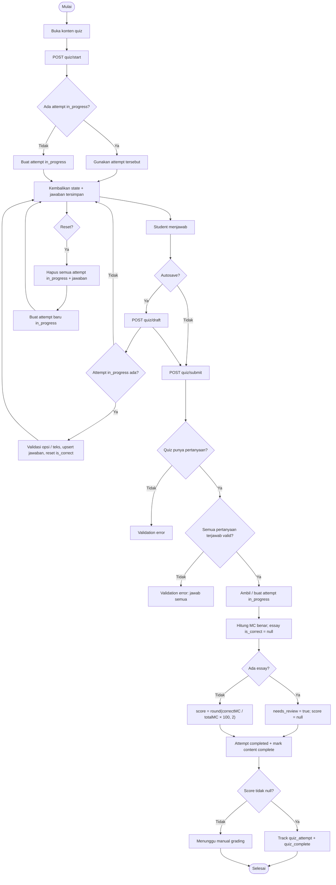

**Catatan audit**

- Submit selalu menandai konten quiz selesai, terlepas dari skor.
- Jika quiz hanya berisi essay, skor `null` dan `needs_review = true`; tidak ada skor sempurna otomatis.
- Draft tidak pernah membuat attempt baru; autosave setelah submit tidak membuka attempt baru.
- Reset hanya menghapus attempt yang masih `in_progress`; attempt selesai tetap tersimpan sebagai histori.

---

## 15. Manual Grading Quiz

**Bukti:** `QuizGradingController`, `QuizService::gradeAttempt`, route `admin.quiz-attempts.*` dan `instructor.quiz-attempts.*`.

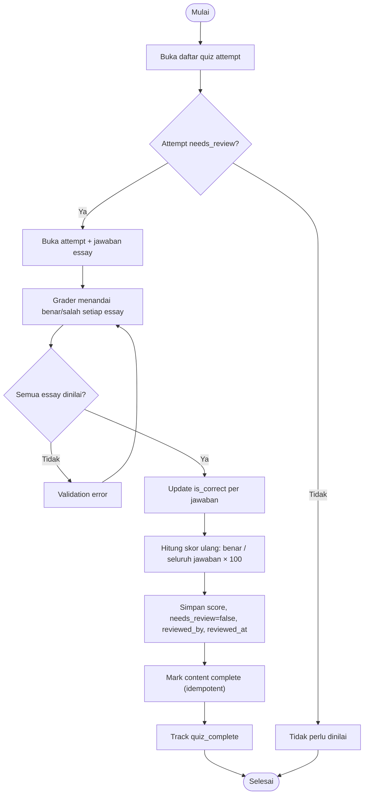

**Catatan audit**

- Skor akhir dihitung dari **seluruh jawaban** (MC + essay), bukan hanya essay.
- Grader dapat berupa admin atau instructor; route terpisah untuk masing-masing role.
- Grading ulang attempt yang sudah `needs_review = false` ditolak.

---

## 16. Sertifikat: Generate, Download, Verifikasi, Template

**Bukti:** `CertificateService`, `CertificateController`, `CertificateTemplateController`, `EnrollmentService::markProgress`.

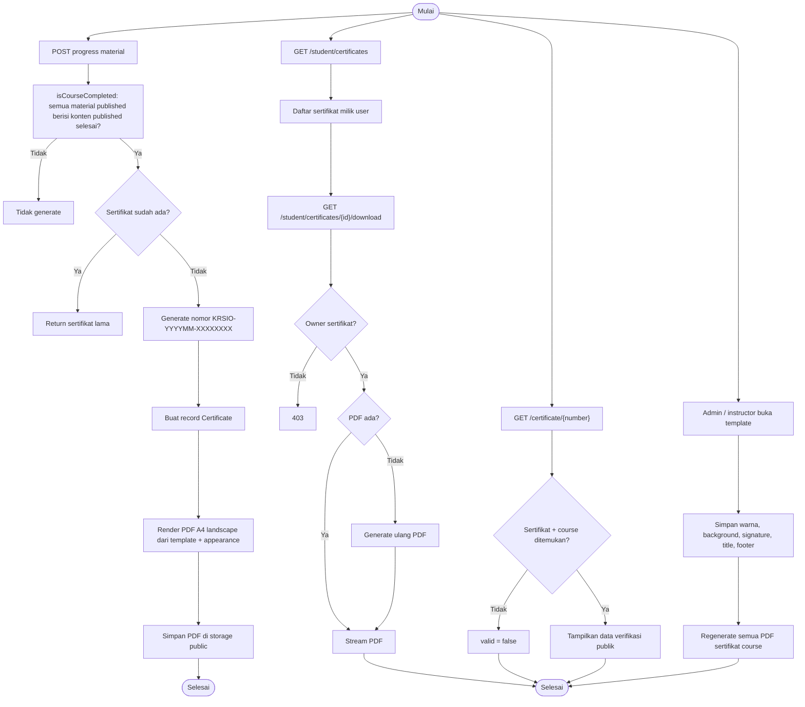

**Catatan audit**

- Generate otomatis hanya dipicu dari `EnrollmentService::markProgress()` → `generateIfCompleted()`.
- `CertificateController@download` dapat meregenerasi PDF jika file hilang.
- Verifikasi publik memakai `withTrashed()` untuk user/course; course yang sudah di-soft-delete masih dapat tampil sebagai valid selama record sertifikat dan course (trashed) ada.
- Perubahan template akan meregenerasi seluruh sertifikat course tersebut.

---

## 17. Review Kursus

**Bukti:** `ReviewController`, `ReviewService`, request `StoreReviewRequest`, migration `reviews`.

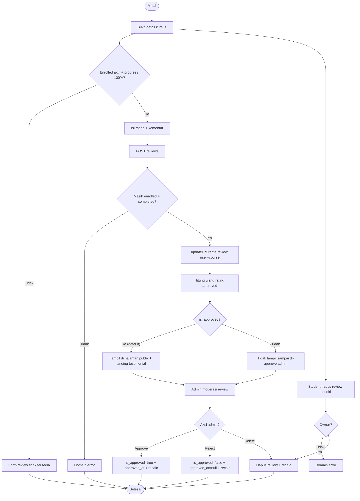

**Catatan audit**

- Migration memberi `is_approved` default `true`, sehingga review langsung tampil. Moderasi bersifat **post-publication**, bukan pre-moderation.
- Update review tidak mereset `is_approved`; review yang pernah ditolak dapat berubah isi tanpa masuk antrean moderasi ulang.
- Rating course dihitung hanya dari review approved.
- Landing testimonial hanya mengambil review approved yang memiliki komentar dan rating minimal sesuai `min_rating` (default 4).

---

## 18. Komentar / Diskusi Kursus

**Bukti:** `CommentController`, `CommentService`, request `StoreCommentRequest`/`UpdateCommentRequest`, migration `comments`.

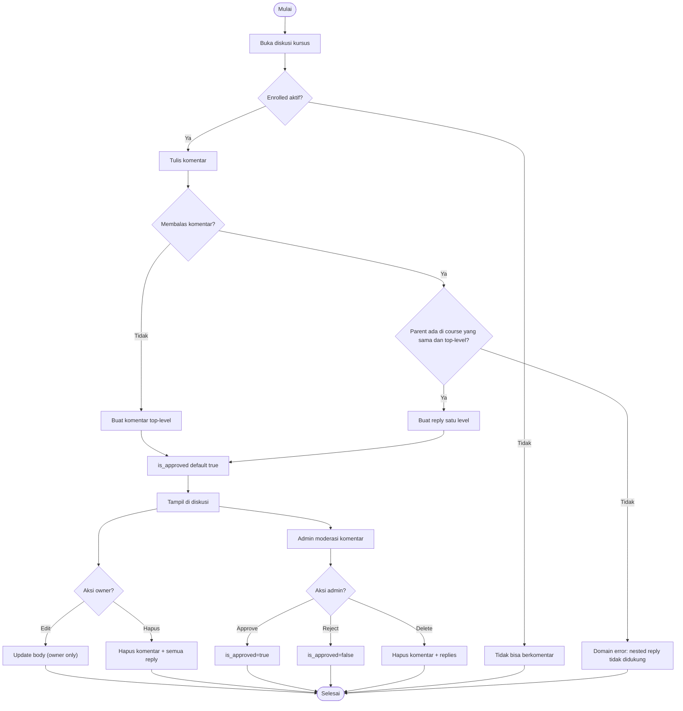

**Catatan audit**

- Komentar juga default approved, sehingga moderasi terjadi setelah publikasi.
- Hanya satu level reply; reply ke reply ditolak.
- Menghapus komentar parent menghapus seluruh reply-nya.
- Komentar yang dihapus tidak memiliki alur restore.

---

## 19. Authoring Kursus: Course, Module, Material, Content, Quiz, Resource

**Bukti:** `CourseController`, `ModuleController`, `MaterialController`, `MaterialContentController`, `QuizController`, `CourseResourceController`, `CourseService`.

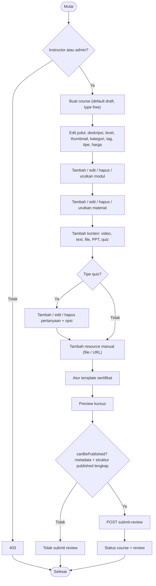

**Catatan audit**

- Course baru selalu `draft` dan `type = free`; harga dihapus jika tipe diubah menjadi free.
- `canBePublished()` mensyaratkan judul, deskripsi, level, thumbnail, minimal satu kategori, serta minimal satu **modul published** yang berisi **material published** dengan **konten published**. Modul draft saja tidak cukup.
- Course dapat dihapus (soft delete) oleh admin atau instructor pemilik melalui endpoint destroy; relasi dan sertifikat lama tidak otomatis dihapus.
- Route move module dan material berfungsi tetapi **tidak memiliki name**; route move content memiliki name.
- Instructor hanya dapat mengelola course miliknya melalui `can:update,course`; admin dapat mengelola semua course.
- Preview tersedia untuk instructor dan admin.

---

## 20. Submit Review dan Approval Kursus

**Bukti:** `CourseService::submitForReview`, `CourseService::update`, `CourseApprovalService::approve`, `CourseApprovalController`.

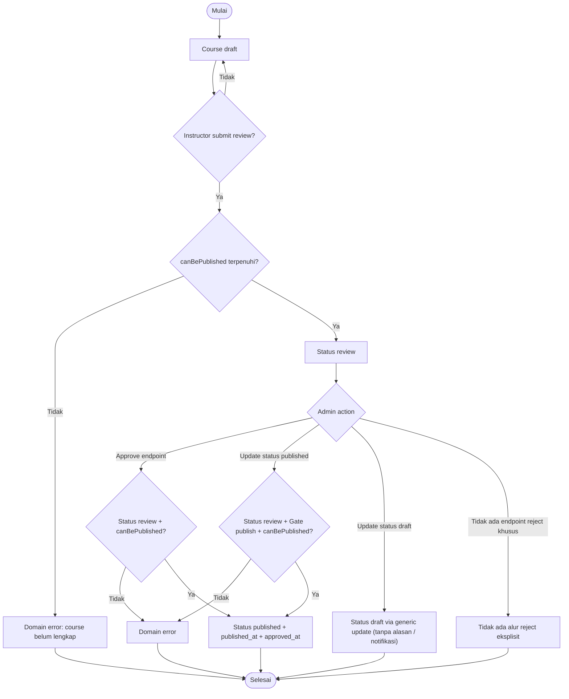

**Catatan audit**

- Approval endpoint hanya `review → published`. Tidak ada endpoint reject/return dengan alasan.
- Admin masih dapat mengubah status ke `draft` melalui endpoint update generik (`UpdateCourseRequest` menerima `draft`, `review`, `published`), tetapi itu bukan alur reject khusus: tidak ada alasan penolakan, notifikasi, atau status `rejected`.
- `CourseService::update()` juga memblokir publish jika course belum berstatus `review`.
- `Gate::authorize('publish')` memastikan hanya admin yang dapat mempublikasikan.
- Instructor tidak dapat mempublikasikan course sendiri.

---

## 21. Resource Pembelajaran dan Download

**Bukti:** `CourseResourceDownloadController`, `CourseResourceContentDownloadController`, `CourseResource`, `EnrollmentService::isCompleted`, `hasCompletedContent`, `hasCompletedMaterial`.

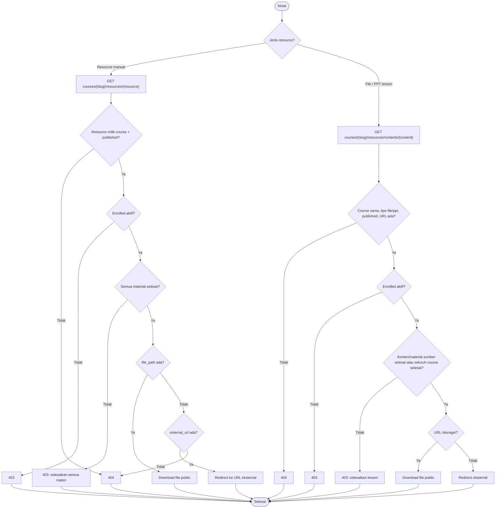

**Catatan audit**

- Resource manual memakai **material completion** (`isCompleted`), bukan content progress.
- Resource lesson file/PPT terbuka per lesson jika konten atau material sumber selesai, atau seluruh course selesai.
- Kedua endpoint memeriksa enrollment aktif dan kepemilikan resource terhadap course.

---

## 22. AI Assistant Chat

**Bukti:** `AI\ChatController`, `ChatService`, `AIOrchestrator`, `AiSettings`, tool classes di `app/Services/AI/Tool`.

```mermaid
flowchart TD
    S(["Mulai"]) --> Open["Buka AI chat"]
    Open --> State{"Aksi?"}
    State -->|"List session"| List["GET /ai/chat/sessions"]
    State -->|"Buat session"| Create{"Jumlah session < 5?"}
    Create -->|"Tidak"| Limit["422: maksimal 5 session"]
    Create -->|"Ya"| New["Buat ChatSession"]
    State -->|"Buka session"| Owner{"Session milik user?"}
    Owner -->|"Tidak"| Forbidden["403"]
    Owner -->|"Ya"| Messages["Load pesan user + assistant"]
    State -->|"Kirim pesan"| Enabled{"AI enabled dan configured?"}
    Enabled -->|"Tidak"| Unavailable["503: disabled / not configured"]
    Enabled -->|"Ya"| Validate{"Pesan <= 1000 karakter?"}
    Validate -->|"Tidak"| Validation["422"]
    Validate -->|"Ya"| SaveUser["Simpan pesan user"]
    SaveUser --> Rename{"Judul masih default?"}
    Rename -->|"Ya"| AutoTitle["Set judul dari 30 karakter pertama"]
    Rename -->|"Tidak"| Context["Bangun konteks 20 pesan terakhir"]
    AutoTitle --> Context
    Context --> Call["Panggil provider AI + tool definitions"]
    Call --> ToolCall{"Ada tool_calls?"}
    ToolCall -->|"Tidak"| Assistant["Simpan + return pesan assistant"]
    ToolCall -->|"Ya"| Loop{"Round <= 5?"}
    Loop -->|"Tidak"| LoopLimit["Return pesan limit tool loop"]
    Loop -->|"Ya"| Exec["Eksekusi tool sesuai role"]
    Exec --> SaveTool["Simpan tool call + hasil"]
    SaveTool --> Call
    Assistant --> State
    LoopLimit --> State
    State -->|"Hapus session"| Delete["Hapus session"]

    List --> Finish(["Selesai"])
    New --> Finish
    Messages --> Finish
    Unavailable --> Finish
    Validation --> Finish
    Limit --> Finish
    Forbidden --> Finish
    Delete --> Finish
```

**Tool yang terdaftar**

| Tool | Akses | Fungsi |
| --- | --- | --- |
| `search_courses` | Student, instructor, admin | Cari kursus published |
| `get_course` | Student, instructor, admin | Detail kursus |
| `get_recommendations` | Student, instructor, admin | Rekomendasi personal |
| `get_user_progress` | Student, instructor, admin | Progress user |
| `compare_courses` | Student, instructor, admin | Bandingkan kursus |
| `get_instructor_students` | Instructor, admin | Daftar student instructor |
| `get_instructor_analytics` | Instructor, admin | Analitik instructor |

**Catatan audit**

- Rate limit kirim pesan `10/menit`; pesan maksimal 1000 karakter.
- `AIOrchestrator` membatasi tool loop maksimal 5 round.
- `LearningPathTool` ada di codebase tetapi **tidak terdaftar** di orchestrator.
- Tidak ada endpoint streaming yang dipakai; chat berjalan sinkron request-response.

---

## 23. Manajemen Provider AI

**Bukti:** `Admin\AiIntegrationController`, `AI\Manager`, `AiSettings`, `GeneralSettingsController`, `AiProviderLog`, `AiUsageLog`, `AiSettingAudit`.

```mermaid
flowchart TD
    S(["Mulai"]) --> Admin["Admin buka Integrations → AI"]
    Admin --> List["Lihat provider, model, usage 30 hari, log terbaru"]
    List --> Action{"Aksi?"}
    Action -->|"Create"| Create["CRUD provider + credentials terenkripsi + config"]
    Action -->|"Update"| Update["Update provider / model / fallback priority"]
    Action -->|"Delete"| Delete{"Masih > 1 provider?"}
    Delete -->|"Tidak"| Keep["Tolak: minimal satu provider"]
    Delete -->|"Ya"| Remove["Hapus + pilih default pengganti"]
    Action -->|"Toggle"| Toggle["Enable / disable provider"]
    Action -->|"Set default"| Default["Pastikan hanya satu default"]
    Action -->|"Test connection"| Test["Panggil provider; throttle 10/menit"]
    Action -->|"Discover models"| Discover["Ambil daftar model; throttle 10/menit"]
    Action -->|"Model capabilities"| Caps["Tambah / edit / hapus model + capability"]
    Action -->|"Import legacy"| Legacy["Migrasi credential lama ke provider"]
    Action -->|"Global toggle"| Global["Aktifkan / nonaktifkan AI assistant"]
    Action -->|"Legacy settings"| PW["Verifikasi password admin"]
    PW --> SaveLegacy["Simpan base_url, model, api_key, provider"]
    Create --> Audit["Tulis audit + usage log"]
    Update --> Audit
    Remove --> Audit
    Toggle --> Audit
    Default --> Audit
    Test --> Audit
    Discover --> Audit
    Caps --> Audit
    Legacy --> Audit
    Global --> Audit
    SaveLegacy --> Audit
    Audit --> Finish(["Selesai"])
    Keep --> Finish
```

**Kontrol keamanan yang terverifikasi**

- Credential disimpan terenkripsi melalui relasi credential provider.
- `UrlGuard` mencegah SSRF; endpoint lokal hanya diizinkan jika config mengizinkan.
- Default provider dipaksa tunggal; disable provider default memilih pengganti.
- Usage dan latency dicatat 30 hari terakhir; audit perubahan settings disimpan.

---

## 24. Recommendation Engine

**Bukti:** `RecommendationService`, `RecommendationSetting`, `EventTrackingService`, config `recommendation.php`.

```mermaid
flowchart TD
    S(["Mulai"]) --> Request["Minta rekomendasi (guest / user)"]
    Request --> Enabled{"ENV recommendation enabled DAN admin switch enabled?"}
    Enabled -->|"Tidak"| Empty["Return array kosong"]
    Enabled -->|"Ya"| Cache{"Cache 2 jam tersedia?"}
    Cache -->|"Ya"| ReturnCache["Return cache"]
    Cache -->|"Tidak"| Driver{"Driver = python?"}
    Driver -->|"Ya"| Python["GET FastAPI /recommendations"]
    Python --> PyOK{"Respons sukses + ada item?"}
    PyOK -->|"Ya"| Hydrate["Hydrate course published + score/reason/tags"]
    Hydrate --> SaveCache["Simpan cache + return"]
    PyOK -->|"Tidak"| Fallback{"Fallback ke Laravel diizinkan?"}
    Fallback -->|"Tidak"| Empty
    Fallback -->|"Ya"| Native["Compute native Laravel"]
    Driver -->|"Tidak"| Native

    Native --> Guest{"User ada?"}
    Guest -->|"Tidak"| Popular["Popular courses"]
    Guest -->|"Ya"| Enrolled["Ambil course enrolled + event user"]
    Enrolled --> Cold{"Tidak ada event?"}
    Cold -->|"Ya"| Popular
    Cold -->|"Tidak"| Weights["Hitung bobot interaksi per course"]
    Weights --> Tags{"Ada tag pada course interaksi?"}
    Tags -->|"Tidak"| Popular
    Tags -->|"Ya"| Candidate["Ambil kandidat published yang belum enrolled"]
    Candidate --> Score["Score = total bobot tag + rating_avg × 0.2"]
    Score --> Rank["Urutkan + limit"]
    Rank --> SaveCache
    Popular --> SaveCache
    SaveCache --> Finish(["Selesai"])
    ReturnCache --> Finish
    Empty --> Finish
```

**Event dan bobot native Laravel**

| Event | Bobot | Throttle |
| --- | --- | --- |
| `course_enroll` | 5 | — |
| `quiz_complete` | 4 | — |
| `material_complete` | 4 | — |
| `quiz_attempt` | 3 | — |
| `material_view` | 2 | 5 menit per user+material |
| `course_view` | 1 | 5 menit per user+course |

**Catatan audit**

- Cache user diinvalidasi pada `course_enroll`, `material_complete`, dan `quiz_complete`.
- Guest hanya mendapat popular fallback.
- Python service memakai timeout 2 detik dan retry 1; kegagalan tidak memblokir UI.
- Toggle rekomendasi admin terpisah dari toggle AI assistant.

---

## 25. Event Tracking dan Pipeline ML

**Bukti:** `EventTrackingService`, `TrackUserEventJob`, `app/Console/Commands/Recommendation*`, `ExportRecommendationDataCommand`, `recommendation-service/`.

```mermaid
flowchart TD
    S(["Mulai"]) --> Trigger{"Trigger event?"}
    Trigger -->|"Buka course"| View["course_view (throttle 5 menit)"]
    Trigger -->|"Enroll"| Enroll["course_enroll"]
    Trigger -->|"Buka material"| MView["material_view (throttle 5 menit)"]
    Trigger -->|"Selesaikan material"| MComplete["material_complete"]
    Trigger -->|"Submit quiz"| Attempt["quiz_attempt"]
    Trigger -->|"Quiz selesai / dinilai"| QComplete["quiz_complete"]
    View --> Store["Simpan UserEvent"]
    Enroll --> Store
    MView --> Store
    MComplete --> Store
    Attempt --> Store
    QComplete --> Store
    Store --> Invalidate{"Event signifikan?"}
    Invalidate -->|"Ya"| Cache["Invalidate cache rekomendasi user"]
    Invalidate -->|"Tidak"| Done(["Selesai"])
    Cache --> Done

    Store --> Export["php artisan recommendation:export"]
    Export --> Train["php artisan recommendation:train"]
    Train --> Status["recommendation:status / stats / evaluate"]
    Status --> Python["FastAPI recommendation service"]
    Python --> API["GET /api/v1/recommendations/*"]
    API --> Done

    Seed["recommendation:seed-events"] --> Store
```

**Perintah artisan yang tersedia**

| Command | Fungsi |
| --- | --- |
| `recommendation:export` | Export dataset event |
| `recommendation:train` | Latih model Python |
| `recommendation:status` | Status model / service |
| `recommendation:stats` | Statistik dataset |
| `recommendation:evaluate` | Evaluasi model |
| `recommendation:seed-events` | Seed event untuk pengujian |

---

## 26. Notifikasi WhatsApp: Enrollment dan Payout

**Bukti:** `EnrollmentService::dispatchWhatsAppNotification`, `SendWhatsAppEnrollmentNotificationJob`, `SendPayoutPaidNotificationJob`, `WhatsApp\Manager`, `WhatsAppService`, `WhatsAppDeliveryLog`.

```mermaid
flowchart TD
    S(["Mulai"]) --> Trigger{"Trigger notifikasi?"}
    Trigger -->|"Enrollment aktif"| Check["Instructor whatsapp_notification_enabled + nomor?"]
    Trigger -->|"Payout paid"| PayoutJob["Dispatch SendPayoutPaidNotificationJob"]

    Check -->|"Tidak"| Skip["Tidak kirim"]
    Check -->|"Ya"| EnrollJob["Dispatch SendWhatsAppEnrollmentNotificationJob"]
    EnrollJob --> Queue["Queue worker"]
    PayoutJob --> Queue

    Queue --> Settings{"WhatsApp global enabled + configured?"}
    Settings -->|"Tidak"| Fail["Job gagal / log error"]
    Settings -->|"Ya"| Provider["Pilih provider default / provider_id"]
    Provider --> Send{"Driver provider?"}
    Send -->|"Infobip"| Infobip["POST Infobip API"]
    Send -->|"Meta"| Meta["POST Meta Graph API (template/text)"]
    Send -->|"Custom"| Custom["POST custom endpoint"]
    Infobip --> Result{"Sukses?"}
    Meta --> Result
    Custom --> Result
    Result -->|"Ya"| Log["Simpan WhatsAppMessage + delivery log"]
    Result -->|"Tidak"| Retry{"Retry / backoff tersisa?"}
    Retry -->|"Ya"| Queue
    Retry -->|"Tidak"| Fail
    Log --> Status["Status: queued / sent / delivered / read / failed"]
    Status --> Finish(["Selesai"])
    Skip --> Finish
    Fail --> Finish
```

**Catatan audit**

- Notifikasi WhatsApp hanya untuk **enrollment** dan **payout paid**; belum ada notifikasi order paid atau sertifikat.
- Job memakai retry/backoff dan idempotency key untuk mengurangi duplikasi.
- Instructor dapat mengatur nomor dan toggle notifikasi sendiri; admin mengatur provider global.
- Test message dan test connection memiliki throttle terpisah.

---

## 27. WhatsApp Webhook

**Bukti:** `Webhooks\WhatsAppWebhookController`, `WhatsApp\Manager::parseWebhook`, `WhatsAppWebhook`, `WhatsAppMessage`, `WhatsAppDeliveryLog`.

```mermaid
flowchart TD
    S(["Mulai"]) --> Method{"HTTP method?"}

    Method -->|"GET verify"| VProvider["Cari provider berdasarkan slug"]
    VProvider --> VDriver{"Driver Meta?"}
    VDriver -->|"Tidak"| V405["405"]
    VDriver -->|"Ya"| VToken{"Verify token dikonfigurasi?"}
    VToken -->|"Tidak"| V403a["403"]
    VToken -->|"Ya"| VMode{"hub.mode = subscribe dan token cocok?"}
    VMode -->|"Tidak"| V403b["403"]
    VMode -->|"Ya"| VChallenge["200 + hub.challenge"]

    Method -->|"POST event"| PProvider["Cari provider"]
    PProvider --> Enabled{"Provider enabled?"}
    Enabled -->|"Tidak"| P404["404"]
    Enabled -->|"Ya"| Parse["Parse payload + verifikasi signature/HMAC"]
    Parse --> ParseOK{"Valid?"}
    ParseOK -->|"Tidak"| Reject["Simpan webhook rejected + 403"]
    ParseOK -->|"Ya"| Record["Simpan WhatsAppWebhook status received"]
    Record --> Tx["Transaksi: persist messages + statuses"]
    Tx --> TxOK{"Berhasil?"}
    TxOK -->|"Tidak"| Failed["Webhook failed + 500"]
    TxOK -->|"Ya"| Processed["Webhook processed + 200"]
    Processed --> Finish(["Selesai"])

    Tx --> Msg["Pesan masuk: contact + conversation + message"]
    Msg --> Dedup{"provider_message_id sudah ada?"}
    Dedup -->|"Ya"| Skip["Skip duplikat"]
    Dedup -->|"Tidak"| SaveMsg["Simpan inbound message"]
    Tx --> Stat["Status: delivered / read / failed"]
    Stat --> Update["Update message + delivery log"]
    VChallenge --> Finish
    V405 --> Finish
    V403a --> Finish
    V403b --> Finish
    Reject --> Finish
    Failed --> Finish
    P404 --> Finish
    Skip --> Finish
    SaveMsg --> Finish
    Update --> Finish
```

**Catatan audit**

- Hanya driver Meta yang mendukung GET verification.
- Throttle webhook `120/menit`.
- Status provider dinormalisasi ke `queued | sent | delivered | read | failed`.
- Webhook mentah tetap disimpan untuk audit, termasuk payload yang ditolak.

---

## 28. Manajemen Provider WhatsApp

**Bukti:** `Admin\WhatsAppIntegrationController`, `WhatsApp\Manager`, `WhatsAppProvider`, `WhatsAppMessageTemplate`, `WhatsAppSetting`.

```mermaid
flowchart TD
    S(["Mulai"]) --> Admin["Admin buka Integrations → WhatsApp"]
    Admin --> List["Lihat provider, statistik pesan, log, template"]
    List --> Action{"Aksi?"}
    Action -->|"Create"| Create["CRUD provider + credential + config"]
    Action -->|"Update"| Update["Update provider / fallback / timeout"]
    Action -->|"Delete"| Delete{"Masih > 1 provider?"}
    Delete -->|"Tidak"| Keep["Tolak: minimal satu provider"]
    Delete -->|"Ya"| Remove["Hapus + default pengganti"]
    Action -->|"Toggle"| Toggle["Enable / disable + default handling"]
    Action -->|"Set default"| Default["Set default + enabled"]
    Action -->|"Test connection"| Test["Test provider; throttle 10/menit"]
    Action -->|"Send test"| SendTest["Kirim pesan uji; throttle 10/menit"]
    Action -->|"Template"| Template["Tambah / hapus template + status"]
    Action -->|"Message status"| Status["Cek status pesan ke provider"]
    Action -->|"Import legacy"| Legacy["Migrasi credential WhatsApp lama"]
    Action -->|"Global toggle"| Global["Aktifkan / nonaktifkan WhatsApp"]
    Create --> Audit["Audit log"]
    Update --> Audit
    Remove --> Audit
    Toggle --> Audit
    Default --> Audit
    Test --> Audit
    SendTest --> Audit
    Template --> Audit
    Status --> Audit
    Legacy --> Audit
    Global --> Audit
    Audit --> Finish(["Selesai"])
    Keep --> Finish
```

**Catatan audit**

- Minimal satu provider harus tetap ada.
- Credential disimpan terenkripsi; URL eksternal dilindungi `UrlGuard`.
- Template memiliki status `approved | pending | rejected | disabled`.
- Test connection dan send test dibatasi `10/menit`; test dari instructor `5/menit`.

---

## 29. Landing Page CMS

**Bukti:** `LandingSettingsController`, `LandingSetting`, `LandingService`, `LandingController`, `ReviewService`.

```mermaid
flowchart TD
    S(["Mulai"]) --> Admin["Admin buka Landing settings"]
    Admin --> Section{"Pilih section"}
    Section -->|"hero"| Hero["Edit hero + upload photos/avatars"]
    Section -->|"about"| About["Edit about"]
    Section -->|"courses"| Courses["Edit section kursus + limit"]
    Section -->|"career"| Career["Edit career"]
    Section -->|"testimonial"| Testi["Pilih/lihat testimoni dari review approved"]
    Section -->|"cta"| Cta["Edit CTA"]
    Section -->|"footer"| Footer["Edit footer"]
    Hero --> Validate{"File gambar valid? jpg/png/webp/gif <= 4MB"}
    Validate -->|"Tidak"| Error["Validation error"]
    Validate -->|"Ya"| Save["Simpan LandingSetting section"]
    About --> Save
    Courses --> Save
    Career --> Save
    Testi --> Save
    Cta --> Save
    Footer --> Save
    Save --> Cleanup["Hapus file hero lama yang tidak dipakai"]
    Cleanup --> Public["Landing publik membaca setting + course published + testimoni approved"]
    Public --> Finish(["Selesai"])
    Error --> Finish
```

**Catatan audit**

- Section yang tersedia: `hero`, `about`, `courses`, `career`, `testimonial`, `cta`, `footer`.
- Upload hero hanya untuk section hero; file lama di storage dibersihkan jika diganti.
- Testimoni diambil dari review approved, bukan input manual terpisah.
- Limit jumlah course di section courses dapat dikonfigurasi.

---

## 30. Pengaturan Umum, Pembayaran, dan Toggle Integrasi

**Bukti:** `GeneralSettingsController`, `AppearanceSetting`, `PaymentSettings`, `AiSettings`, `WhatsAppSetting`, `RecommendationSetting`.

```mermaid
flowchart TD
    S(["Mulai"]) --> Admin["Admin buka Settings"]
    Admin --> Action{"Jenis pengaturan?"}
    Action -->|"Appearance"| Palette["Pilih palette"]
    Action -->|"Identity"| Identity["Ubah app_name + contact_email"]
    Action -->|"Logo"| Logo{"Upload atau hapus?"}
    Logo -->|"Upload"| Upload["Validasi gambar <= 2MB + simpan + hapus lama"]
    Logo -->|"Hapus"| DeleteLogo["Hapus file + kembali default"]
    Action -->|"Payment"| Payment["Gateway Midtrans + currency IDR"]
    Payment --> Fee["Platform fee 0-100%"]
    Payment --> Hold["Payout hold 0-90 hari"]
    Payment --> Min["Minimum payout"]
    Payment --> Lock["Account lock 0-168 jam"]
    Fee --> Sync["Sync provider + metode Midtrans"]
    Hold --> Sync
    Min --> Sync
    Lock --> Sync
    Action -->|"AI toggle"| AiToggle["Enable / disable AI"]
    Action -->|"Recommendation toggle"| RecToggle["Enable / disable rekomendasi Python"]
    Action -->|"WhatsApp toggle"| WaToggle["Enable / disable WhatsApp"]
    Action -->|"Legacy AI settings"| AiCred["Verifikasi password + simpan credential"]
    Action -->|"Legacy WhatsApp settings"| WaCred["Simpan credential WhatsApp"]
    Palette --> Save["Simpan + redirect sukses"]
    Identity --> Save
    Upload --> Save
    DeleteLogo --> Save
    Sync --> Save
    AiToggle --> Save
    RecToggle --> Save
    WaToggle --> Save
    AiCred --> Save
    WaCred --> Save
    Save --> Finish(["Selesai"])
```

**Catatan audit**

- Payment gateway dikunci ke Midtrans dan currency ke IDR; nilai lain ditolak.
- Menyimpan gateway akan menyinkronkan provider Midtrans dan metode default (Credit Card, QRIS, Virtual Account, GoPay).
- Pengaturan AI/WhatsApp legacy tetap ada di samping integrasi provider baru.
- Perubahan AI settings diaudit dan memerlukan verifikasi password admin.

---

## 31. Manajemen User, Kategori/Tag, dan Profil

**Bukti:** `UserController`, `UserService`, `StoreUserRequest`, `UpdateUserRequest`, policy `UserPolicy`.

```mermaid
flowchart TD
    S(["Mulai"]) --> Admin["Admin buka Users"]
    Admin --> Action{"Aksi?"}
    Action -->|"List / search / filter role"| List["Tampilkan user + count course/enrollment"]
    Action -->|"Create"| Create["Buat user dengan role admin/instructor/student"]
    Action -->|"Update"| Update["Update nama, email, role, bio, avatar, password opsional"]
    Action -->|"Delete"| Delete["Soft delete user"]
    Delete --> Revoke["Revoke semua enrollment user"]
    Revoke --> Sessions["Hapus session user"]
    Sessions --> Done["User deleted"]
    Action -->|"Export"| Export["CSV user: filter search + role"]
    Action -->|"Profile"| Profile["Lihat profil admin + course yang dibuat"]
    List --> Finish(["Selesai"])
    Create --> Finish
    Update --> Finish
    Done --> Finish
    Export --> Finish
    Profile --> Finish
```

**Catatan audit**

- Delete user bersifat soft delete dan mencabut enrollment, tetapi tidak menghapus review/komentar secara eksplisit.
- Export user memakai filter yang sama dengan daftar user.
- Perubahan role oleh admin tidak melalui alur onboarding `/choose-role`.

### 31.1 Kategori dan Tag

**Bukti:** `CategoryController`, `TagController`, `CategoryService`, `TagService`, request Category/Tag, policy Category/Tag.

```mermaid
flowchart TD
    S(["Mulai"]) --> Admin["Admin buka kategori / tag"]
    Admin --> Kind{"Jenis data?"}
    Kind -->|"Kategori"| CatList["Lihat daftar kategori"]
    CatList --> CatAction{"Aksi kategori?"}
    CatAction -->|"Create"| CatCreate["Validasi + buat kategori"]
    CatAction -->|"Update"| CatUpdate["Validasi + update kategori"]
    CatAction -->|"Delete"| CatDelete{"Policy delete?"}
    CatDelete -->|"Tidak"| Forbidden["403"]
    CatDelete -->|"Ya"| CatDestroy["Hapus kategori"]

    Kind -->|"Tag"| TagList["Lihat tag + jumlah course"]
    TagList --> TagAction{"Aksi tag?"}
    TagAction -->|"Create"| TagCreate["Validasi + buat tag"]
    TagAction -->|"Update"| TagUpdate["Validasi + update tag"]
    TagAction -->|"Delete"| TagDelete{"Policy delete?"}
    TagDelete -->|"Tidak"| Forbidden
    TagDelete -->|"Ya"| TagDestroy["Hapus tag"]

    CatCreate --> Finish(["Selesai"])
    CatUpdate --> Finish
    CatDestroy --> Finish
    TagCreate --> Finish
    TagUpdate --> Finish
    TagDestroy --> Finish
    Forbidden --> Finish
```

**Catatan audit**

- Kategori dan tag dipakai saat authoring course (`category_ids`, `tag_ids`) dan oleh recommendation engine.
- Penghapusan kategori/tag mengikuti policy dan dapat memengaruhi relasi course; tidak ada alur penggabungan (merge) kategori/tag.

### 31.2 Profil dan Pengaturan Student/Instructor

**Bukti:** `StudentProfileController`, `InstructorProfileController`, `InstructorSettingsController`, `UpdateUserRequest`, `UpdateInstructorProfileRequest`, `UserService::update`.

```mermaid
flowchart TD
    S(["Mulai"]) --> Role{"Role?"}

    Role -->|"Student"| StudentProfile["GET /student/profile"]
    StudentProfile --> StudentEdit["Edit nama, email, bio, avatar, password opsional"]
    StudentEdit --> StudentSave["PUT /student/profile"]
    StudentSave --> StudentAuth{"Field role dikirim?"}
    StudentAuth -->|"Ya"| RoleIgnored["Diabaikan; hanya admin yang boleh ubah role"]
    StudentAuth -->|"Tidak"| StudentUpdate["Update user + avatar"]
    RoleIgnored --> StudentUpdate
    StudentUpdate --> StudentDone["Redirect profil + sukses"]

    Role -->|"Student settings"| StudentSettings["GET /student/settings"]
    StudentSettings --> WaForm["Atur nomor WhatsApp + toggle notifikasi"]
    WaForm --> WaEnabled{"Toggle aktif?"}
    WaEnabled -->|"Tidak"| WaSave["PUT /student/settings/whatsapp"]
    WaEnabled -->|"Ya"| WaRequired{"Nomor diisi? (required_if)"}
    WaRequired -->|"Tidak"| WaError["Validation error"]
    WaRequired -->|"Ya"| WaClean["Bersihkan spasi / tanda hubung"]
    WaClean --> WaLength{"Panjang 9-16 digit?"}
    WaLength -->|"Tidak"| WaNull["Nomor disimpan null; toggle bisa tetap aktif"]
    WaLength -->|"Ya"| WaSave
    WaNull --> WaSave

    Role -->|"Instructor"| InstructorProfile["GET /instructor/profile"]
    InstructorProfile --> InstructorEdit["Edit nama, email, bio, avatar, password opsional"]
    InstructorEdit --> InstructorSave["PUT /instructor/profile"]
    InstructorSave --> InstructorUpdate["Update user + avatar"]

    Role -->|"Instructor settings"| InstructorSettings["GET /instructor/settings"]
    InstructorSettings --> PayoutForm["Atur rekening payout"]
    PayoutForm --> PayoutGuard{"Rekening sudah lengkap dan berubah?"}
    PayoutGuard -->|"Ya"| Password["Wajib password + audit + lock"]
    PayoutGuard -->|"Tidak"| PayoutSave["Simpan rekening"]
    Password --> PayoutSave
    InstructorSettings --> InstWa["Atur WhatsApp + test (throttle 5/menit)"]

    StudentDone --> Finish(["Selesai"])
    WaSave --> Finish
    WaError --> Finish
    InstructorUpdate --> Finish
    PayoutSave --> Finish
    InstWa --> Finish
```

**Catatan audit**

- Student memakai `UpdateUserRequest` yang sama dengan admin; rule `role` hanya ditambahkan jika user yang login adalah admin, sehingga student tidak dapat menaikkan role lewat profil.
- Instructor memakai `UpdateInstructorProfileRequest` dengan nama/email wajib.
- Perubahan rekening payout setelah setup pertama memerlukan password, menulis `PayoutAccountAudit`, dan memicu account lock.
- Nomor WhatsApp student dibersihkan dari spasi/tanda hubung. Namun panjang 9–16 digit hanya dicek untuk menentukan nilai yang disimpan; jika tidak memenuhi, nomor menjadi `null` **tanpa validation error**, sementara toggle notifikasi dapat tetap aktif. Ini perlu diperbaiki jika ingin validasi yang tegas.

---

## 32. Export Data

**Bukti:** `Admin\ExportController`, `PayoutController@exportCsv`, `CourseStudentsExportController`, `CsvExport`.

```mermaid
flowchart TD
    S(["Mulai"]) --> Kind{"Jenis export?"}
    Kind -->|"Orders"| Orders["CSV order + payment + refund/chargeback"]
    Kind -->|"Users"| Users["CSV user + filter search/role"]
    Kind -->|"Payouts"| Payouts["CSV rekap payout per instruktur"]
    Kind -->|"Course students"| Students["CSV student + progress course"]
    Orders --> Auth{"Admin?"}
    Users --> Auth
    Payouts --> Auth
    Students --> Owner{"Admin atau instructor pemilik course?"}
    Auth -->|"Tidak"| Forbidden["403"]
    Auth -->|"Ya"| Stream["Stream download CSV"]
    Owner -->|"Tidak"| Forbidden
    Owner -->|"Ya"| Stream
    Stream --> Finish(["Selesai"])
    Forbidden --> Finish
```

**Catatan audit**

- Export order dan user memakai cursor; seluruh output tetap di-stream sebagai CSV.
- Export course students memakai otorisasi `update` course.
- Tidak ada export PDF.

---

## 33. Dashboard dan Analitik

**Bukti:** `DashboardController`, `DashboardService`, route `/admin/dashboard`, `/student/dashboard`, `/instructor/dashboard`.

```mermaid
flowchart TD
    S(["Mulai"]) --> Role{"Role user?"}
    Role -->|"Admin"| Admin["Admin dashboard"]
    Role -->|"Student"| Student["Student dashboard"]
    Role -->|"Instructor"| Instructor["Instructor dashboard"]

    Admin --> Metrics["Total user, course, enrollment aktif, revenue paid"]
    Metrics --> Top["Top 5 course + recent enrollment/course"]

    Student --> Enrollments["Enrollment aktif + course published"]
    Enrollments --> Progress["Progress material + resume target"]
    Progress --> Certs["Sertifikat user + rekomendasi"]
    Certs --> View["Render dashboard"]

    Instructor --> Courses["Course milik instructor + statistik"]
    Courses --> Students["Jumlah student + progress"]
    Students --> View

    Top --> Finish(["Selesai"])
    View --> Finish
```

**Catatan audit**

- Revenue admin dihitung dari order `paid`, bukan net payout.
- Progress dashboard student memakai `material_progress`; progress bar halaman detail memakai content progress.
- Instructor dashboard memakai view yang sama dengan student (`student/Dashboard`) dengan data berbeda.

---

## 34. Order Management, Admin Mark Paid, dan Expiry

**Bukti:** `Admin\OrderController`, `PaymentService::markPaid`, `releaseOrder`, `ExpirePendingOrders`, `routes/console.php`.

```mermaid
flowchart TD
    S(["Mulai"]) --> Admin["Admin buka Orders"]
    Admin --> Action{"Aksi?"}
    Action -->|"Lihat detail"| Detail["Detail order + payment + refund"]
    Action -->|"Export"| Export["CSV orders"]
    Action -->|"Mark paid"| Mark["PUT orders/{order}/pay"]
    Mark --> Paid["PaymentService::markPaid"]
    Paid --> Effects["Aktivasi enrollment + payout ledger + WhatsApp"]
    Action -->|"Refund"| Refund["POST orders/{order}/refund"]
    Refund --> RefundFlow["Refund / chargeback flow"]

    S --> Scheduler["Scheduler setiap 10 menit"]
    Scheduler --> Expire["orders:expire"]
    Expire --> Pending{"Order pending + expires_at <= now?"}
    Pending -->|"Tidak"| Skip["Lewati"]
    Pending -->|"Ya"| Release["releaseOrder('expired')"]
    Release --> Local["Update payment + order expired"]
    Local --> Remote{"Provider Midtrans?"}
    Remote -->|"Ya"| Call["Best-effort expire transaksi Midtrans"]
    Remote -->|"Tidak"| Done["Selesai"]
    Call --> Done
    Done --> Finish(["Selesai"])
    Effects --> Finish
    RefundFlow --> Finish
    Detail --> Finish
    Export --> Finish
    Skip --> Finish
```

**Catatan audit**

- `orders:expire` berjalan setiap 10 menit dengan `withoutOverlapping` dan `onOneServer`.
- `releaseOrder` hanya memproses order yang masih `pending`; kegagalan call remote tidak membatalkan update lokal.
- Admin mark paid memakai `PaymentService::markPaid`, sehingga enrollment, payout ledger, dan WhatsApp ikut terpicu. Aksi ini memverifikasi status Midtrans terlebih dahulu atau memerlukan `override` + alasan.
- Queue failed jobs dipangkas harian (`queue:prune-failed --hours=168`).

---

## 35. Matriks Audit Fitur → Diagram → Bukti

| No | Fitur / Alur | Diagram | Bukti route / controller / service | Status |
| --- | --- | --- | --- | --- |
| 1 | Landing page + CMS | §5, §29 | `LandingController`, `LandingSettingsController`, `LandingService`, `LandingSetting` | ✅ |
| 2 | Katalog kursus published | §5 | `/course`, `/courses`, `CourseController@index` | ✅ |
| 3 | Detail kursus + review/komentar | §5, §17, §18 | `CourseController@show`, `ReviewService`, `CommentService` | ✅ |
| 4 | Verifikasi sertifikat publik | §5, §16 | `CertificateController@verify`, `/certificate/{number}` | ✅ |
| 5 | Register + login | §4 | `AuthControllers@register/store`, `throttle:6,1` | ✅ |
| 6 | Onboarding role | §4 | `RoleController`, `/choose-role` | ✅ |
| 7 | Verifikasi email | §4 | `verifyEmail`, `resendVerificationEmail` | ⚠️ Tidak ada middleware `verified` |
| 8 | Lupa / reset password | §4 | `forgotPassword`, `resetPassword`, `Password::sendResetLink` | ⚠️ Reset POST tanpa throttle eksplisit |
| 9 | Rekomendasi kursus | §24 | `RecommendationController`, `RecommendationService` | ✅ |
| 10 | Enroll gratis | §6 | `EnrollmentController@store`, `EnrollmentService::enroll` | ✅ |
| 11 | Checkout berbayar | §7 | `CheckoutController`, `PaymentService::createOrder` | ✅ |
| 12 | Halaman pembayaran + sync status | §8 | `PaymentController@show`, `MidtransPaymentGateway::verify` | ✅ |
| 13 | Webhook Midtrans | §9 | `PaymentWebhookController@midtrans` | ✅ |
| 14 | Settlement `paid` | §10 | `PaymentService::markPaid`, `recordPayouts` | ✅ |
| 15 | Refund manual | §11 | `OrderController@refund`, `PaymentService::refund` | ⚠️ Tidak ada pengajuan refund student |
| 16 | Refund webhook + chargeback | §11 | `PaymentWebhookController::handleRefund`, `handleChargeback` | ✅ |
| 17 | Expiry order | §34 | `orders:expire`, `PaymentService::releaseOrder` | ✅ |
| 18 | Payout ledger | §10, §12 | `InstructorPayout`, `recordPayouts` | ✅ |
| 19 | Payout single/batch | §12 | `PayoutController@markPaid/markBatchPaid` | ✅ |
| 20 | Rekening payout + lock | §12 | `InstructorSettingsController@updatePayout`, `PayoutAccountAudit` | ✅ |
| 21 | Learning player + progress | §13 | `EnrollmentController@show/markProgress/markContentProgress` | ⚠️ Dua sistem progress |
| 22 | Quiz start/draft/reset/submit | §14 | `QuizService`, route `/student/courses/{slug}/quiz/*` | ✅ |
| 23 | Manual grading quiz | §15 | `QuizGradingController`, `QuizService::gradeAttempt` | ✅ |
| 24 | Sertifikat otomatis | §16 | `CertificateService::generateIfCompleted`, `markProgress` | ⚠️ Bergantung trigger frontend |
| 25 | Download + template sertifikat | §16 | `CertificateController@download`, `CertificateTemplateController` | ✅ |
| 26 | Review + moderasi | §17 | `ReviewController`, `ReviewService` | ⚠️ Default approved / post-moderation |
| 27 | Komentar + moderasi | §18 | `CommentController`, `CommentService` | ⚠️ Default approved / reply satu level |
| 28 | Authoring course | §19 | `CourseController`, module/material/content/quiz/resource controllers | ✅ |
| 29 | Submit review course | §20 | `CourseService::submitForReview` | ✅ |
| 30 | Approval course | §20 | `CourseApprovalController`, `CourseApprovalService` | ⚠️ Tidak ada reject eksplisit |
| 31 | Resource manual + lesson | §21 | `CourseResourceDownloadController`, `CourseResourceContentDownloadController` | ✅ |
| 32 | AI assistant chat | §22 | `AI\ChatController`, `ChatService`, `AIOrchestrator` | ✅ |
| 33 | Manajemen provider AI | §23 | `AiIntegrationController`, `AI\Manager`, `UrlGuard` | ✅ |
| 34 | Event tracking | §25 | `EventTrackingService`, `TrackUserEventJob` | ✅ |
| 35 | Pipeline ML / command | §25 | `recommendation:*`, `recommendation-service/` | ✅ |
| 36 | Notifikasi WhatsApp enrollment | §26 | `SendWhatsAppEnrollmentNotificationJob`, `WhatsAppService` | ✅ |
| 37 | Notifikasi WhatsApp payout | §26 | `SendPayoutPaidNotificationJob` | ✅ |
| 38 | WhatsApp webhook | §27 | `WhatsAppWebhookController@verify/handle` | ✅ |
| 39 | Manajemen provider WhatsApp | §28 | `WhatsAppIntegrationController`, `WhatsApp\Manager` | ✅ |
| 40 | Landing CMS | §29 | `LandingSettingsController`, `LandingSetting` | ✅ |
| 41 | Settings umum/payment | §30 | `GeneralSettingsController`, `PaymentSettings` | ✅ |
| 42 | Manajemen user | §31 | `UserController`, `UserService`, `UserPolicy` | ✅ |
| 43 | Kategori & tag | §31.1 | `CategoryController`, `TagController`, `CategoryService`, `TagService` | ✅ |
| 44 | Profil & pengaturan student/instructor | §31.2 | `StudentProfileController`, `InstructorProfileController`, `InstructorSettingsController` | ✅ |
| 45 | Export orders/users/payouts/students | §32 | `ExportController`, `PayoutController@exportCsv`, `CourseStudentsExportController` | ✅ |
| 46 | Dashboard admin/student/instructor | §33 | `DashboardController`, `DashboardService` | ✅ |
| 47 | Order admin + mark paid | §34 | `OrderController`, `PaymentService::markPaid` | ✅ |
| 48 | Scheduler + queue | §34 | `routes/console.php`, `ExpirePendingOrders` | ✅ |
| 49 | Halaman legal | — | `LegalController@terms/privacy`, `/terms`, `/privacy` | ✅ (statis) |

---

## 36. Temuan Audit dan Perbedaan yang Perlu Diketahui

Bagian ini merangkum hal yang **benar-benar ditemukan** saat audit dan perlu diperhitungkan saat membaca diagram atau mengembangkan fitur.

### 36.1 Sertifikat tidak dipicu langsung oleh quiz

`QuizService::submitQuiz()` dan `gradeAttempt()` hanya memanggil `markContentCompleted()`. Sertifikat baru dicek pada `EnrollmentService::markProgress()`, yang dipanggil endpoint terpisah `/student/courses/{slug}/progress`. Artinya:

- Jika frontend tidak memanggil endpoint progress material setelah semua konten selesai, sertifikat tidak tergenerate otomatis.
- Quiz submit tidak pernah memanggil `CertificateService` secara langsung.

### 36.2 Dua sistem progress

| Aspek | Content progress | Material progress |
| --- | --- | --- |
| Tabel | `material_content_progress` | `material_progress` |
| Ditulis oleh | `markContentProgress`, quiz submit | `markProgress` |
| Progress bar detail | Ya | Tidak |
| `isCompleted` / review / sertifikat / resource manual | Tidak | Ya |

Konsistensi bergantung pada frontend yang menutup material setelah semua konten selesai. Ini adalah sumber potensial progress bar 100% tetapi sertifikat/resource belum terbuka, atau sebaliknya.

### 36.3 Moderasi review dan komentar bersifat post-publication

Migration `reviews` dan `comments` memberi `is_approved` default `true`. Review/komentar baru langsung tampil. Admin hanya dapat menurunkan visibilitas setelah konten publik.

- Update review tidak mereset approval.
- Update komentar tidak mereset approval.
- Tidak ada antrean “pending” otomatis untuk konten baru.

### 36.4 Tidak ada alur reject course

Approval hanya memiliki transisi `review → published`. Tidak ada endpoint reject/return dengan alasan, tidak ada status `rejected`, dan tidak ada notifikasi ke instructor. Instructor yang perlu revisi harus mengubah course dan alurnya tidak didefinisikan secara eksplisit.

Admin secara teknis masih dapat mengubah status course menjadi `draft` melalui endpoint update generik, karena `UpdateCourseRequest` menerima `draft`, `review`, dan `published`. Namun ini bukan alur reject: tidak ada alasan penolakan, audit khusus, atau pemberitahuan ke instructor.

### 36.5 Refund hanya dari admin/webhook

Tidak ada endpoint student untuk mengajukan refund. Kebijakan refund di halaman course hanya informatif (`EnrollmentService::refundPolicy`). Refund aktual diinisiasi admin atau berasal dari webhook Midtrans.

### 36.6 Verifikasi email tidak menegakkan akses

Route verifikasi dan resend tersedia, tetapi area student/instructor/admin tidak memakai middleware `verified`. User yang belum verifikasi tetap dapat login dan belajar.

### 36.7 Route move yang tidak bernama

- `PUT /modules/{module}/move` berfungsi tetapi tidak memiliki `->name()`.
- `PUT /modules/{module}/materials/{material}/move` juga tidak memiliki name.
- `contents/{content}/move` memiliki name `contents.move`.

Ini tidak memutus alur, tetapi menyulitkan generate URL berbasis nama route dan perlu diperhatikan saat refactor.

### 36.8 Fitur yang dibuat tetapi belum terhubung

- `LearningPathTool` tidak terdaftar di `AIOrchestrator`.
- Adapter streaming AI ada, tetapi tidak ada endpoint chat streaming yang dipakai.
- `role.selected` middleware terdaftar tetapi tidak dipakai.
- Notifikasi WhatsApp order paid dan sertifikat belum ada; yang ada hanya enrollment dan payout.
- Tidak ada PDF export (selain sertifikat) dan tidak ada impersonation.

### 36.9 Perilaku payout yang perlu dipahami

- Hold period dihitung dari `now()` saat ledger dibuat, bukan dari `paid_at` order secara eksplisit.
- Payout ledger tidak dibuat jika course sudah tidak ada atau tidak punya creator.
- Perubahan rekening pertama tidak memicu lock; perubahan berikutnya memicu lock dan audit.
- Batch payout tidak memanggil API bank; admin menandai “sudah ditransfer” secara manual.

### 36.10 Perilaku refund/chargeback

- Refund parsial mempertahankan akses dan status order `paid`.
- Refund penuh mencabut enrollment dan membatalkan payout pending.
- Chargeback selalu mencabut akses dan membatalkan payout pending, termasuk nominal parsial.
- Idempotency memakai `refund_key`; refund webhook dicocokkan juga berdasarkan payment + amount.

### 36.11 Batasan platform yang masih berlaku

- Hanya Midtrans, hanya IDR.
- Tidak ada multi-gateway, multi-currency, atau marketplace multi-instructor.
- Tidak ada refund request endpoint.
- Tidak ada reject flow course.
- Tidak ada notifikasi WhatsApp untuk order/certificate.
- Tidak ada AI streaming endpoint yang aktif.
- Tidak ada impersonation atau PDF export umum.

### 36.12 Validasi nomor WhatsApp student tidak tegas

`StudentProfileController@updateWhatsApp` mewajibkan nomor jika toggle aktif (`required_if`), tetapi setelah dibersihkan, nomor yang panjangnya di luar 9–16 digit akan disimpan sebagai `null` tanpa melempar validation error. Akibatnya toggle bisa tetap `true` sementara nomor kosong. Job notifikasi akan berhenti karena nomor tidak tersedia, tetapi konfigurasi UI terlihat aktif.

---

## 37. Checklist Konsistensi Alur

Gunakan checklist ini saat mengubah fitur agar diagram tetap akurat.

- [ ] Route baru sudah masuk diagram dan matriks audit.
- [ ] Status order/payment baru sudah dipetakan di webhook dan refund.
- [ ] Perubahan progress content/material memperbarui §13 dan §36.2.
- [ ] Perubahan aturan sertifikat memperbarui §16 dan §36.1.
- [ ] Perubahan moderasi review/komentar memperbarui §17, §18, dan §36.3.
- [ ] Perubahan approval course memperbarui §20 dan §36.4.
- [ ] Perubahan payout memperbarui §12 dan §36.9.
- [ ] Perubahan AI tools memperbarui §22 dan §36.8.
- [ ] Perubahan provider AI/WhatsApp memperbarui §23, §27, dan §28.
- [ ] Perubahan kategori/tag/profil memperbarui §31.1 dan §31.2.
- [ ] Perubahan scheduler/job memperbarui §34 dan §26.
- [ ] Semua label Mermaid dengan karakter khusus tetap dalam tanda kutip.
- [ ] Tidak menggunakan `end` sebagai node akhir.

---

## 38. Catatan Rendering

- Diagram memakai blok fenced code dengan bahasa `mermaid` dan dirender otomatis di GitHub, GitLab, Notion, dan renderer Mermaid lain.
- Notasi activity diagram disimulasikan dengan `flowchart TD`; Mermaid tidak memiliki activity diagram UML native.
- Start/end memakai node lingkaran `(["..."])`; decision memakai `{"..."}`.
- Untuk diagram yang sangat besar, pecah per fitur seperti pada dokumen ini agar tetap terbaca.
- Jika Mermaid gagal render, periksa label yang mengandung `()`, `/`, `:`, `?`, atau `|` — pastikan berada di dalam tanda kutip.
- Dokumen ini fokus pada alur implementasi, bukan janji produk. Perbedaan antara README/PRD dan kode dicatat di §36.
