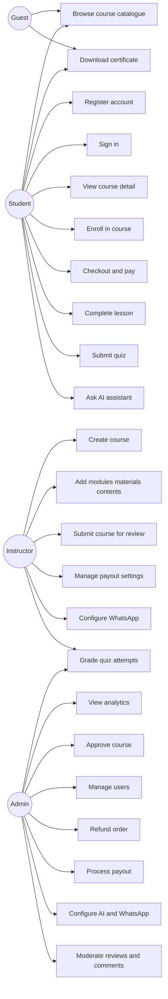
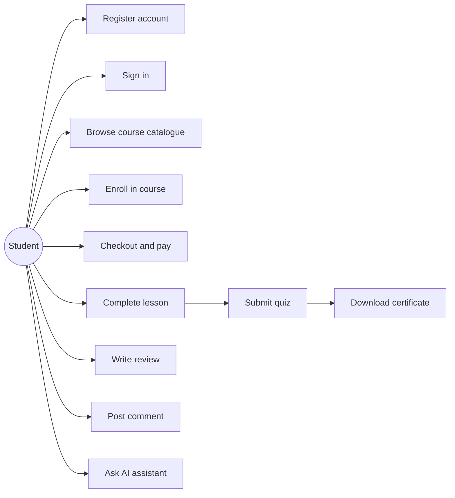
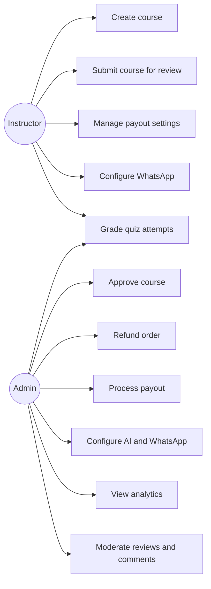
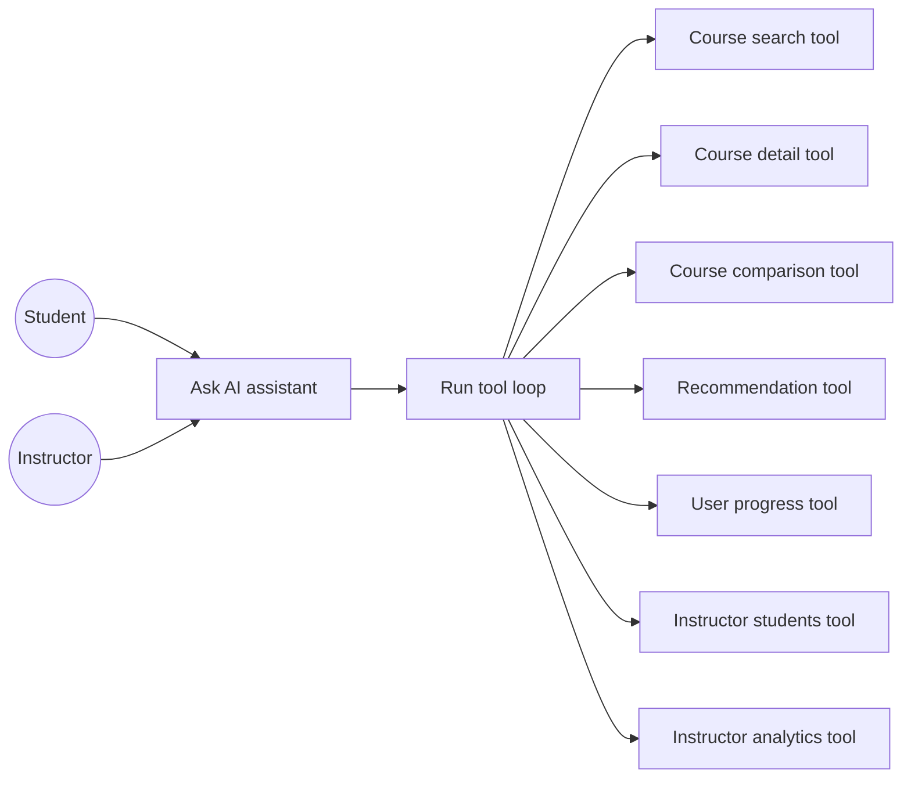
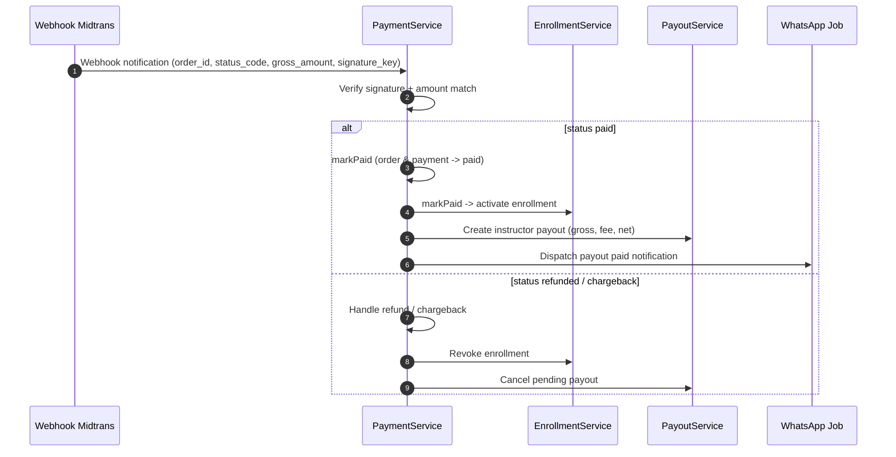
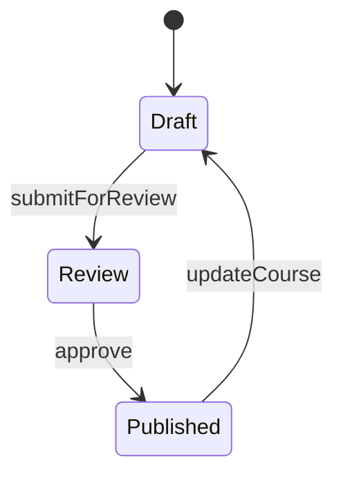

# Use Case Diagram — KursusIO

> Berdasarkan fitur yang terekam di [README.md](../README.md).

Dokumen ini berisi **use case diagram** berbentuk Mermaid yang dirender otomatis pada GitHub. Sintaks mengikuti format diagram use case bawaan Mermaid (aktor berbentuk lingkaran, use case berbentuk persegi).

> Alur langkah demi langkah untuk setiap fitur tersedia di [activity-diagram.md](./activity-diagram.md), termasuk cabang kegagalan, webhook, job asinkron, dan temuan audit.

---

## 1. Actor Utama

| Actor        | Deskripsi                                                                                 |
| ------------ | ----------------------------------------------------------------------------------------- |
| Guest        | Pengunjung publik: melihat landing, katalog, detail kursus, sertifikat, AI.               |
| Student      | Pengguna yang belajar: enroll, checkout, belajar, quiz, sertifikat, review, komentar, AI. |
| Instructor   | Penyusun kursus: membuat kurikulum, submit, payout, WhatsApp, AI tools.                   |
| Admin        | Pengelola platform: approval, user, order, payout, moderation, konfigurasi.               |
| AI Assistant | Sistem rekomendasi/asisten AI (internal, bukan aktor manusia).                            |

---

## 2. Use Case Diagram — Sistem KursusIO

### Penjelasan Use Case

| Use Case                                       | Actor                      | Deskripsi                                                                      |
| ---------------------------------------------- | -------------------------- | ------------------------------------------------------------------------------ |
| Browse course catalogue                        | Guest, Student             | Melihat landing, katalog publik, course detail, rekomendasi.                   |
| Verify certificate                             | Guest                      | Memverifikasi nomor sertifikat publik.                                         |
| Register account / Sign in                     | Student                    | Registrasi, login, verifikasi email, reset password.                           |
| Enroll in course                               | Student                    | Enroll gratis atau via checkout course berbayar.                               |
| Checkout and pay                               | Student                    | Checkout → Midtrans → order paid → enroll aktif.                               |
| Complete lesson                                | Student                    | Content player → progress → material complete → auto material-level.           |
| Submit quiz                                    | Student                    | Quiz lifecycle: start/draft/reset/submit; MC auto-grade; essay needs_review.   |
| Grade quiz attempts                            | Admin, Instructor          | Manual grade essay answers (needs_review); recompute score; mark complete.     |
| Download certificate                           | Student                    | Selesai → generate → download PDF.                                             |
| Ask AI assistant                               | Student, Instructor        | Chat AI + tool calling + rate limit.                                           |
| Create course / Add modules materials contents | Instructor                 | Pembuatan & pengelolaan kurikulum.                                             |
| Submit course for review                       | Instructor                 | Kirim ke admin untuk approve.                                                  |
| Manage payout settings                         | Instructor                 | Konfigurasi bank, fee, hold, minimum, lock.                                    |
| Configure WhatsApp                             | Instructor, Admin          | Provider, template, notifikasi, webhook.                                       |
| View analytics                                 | Admin                      | Dashboard KPI, top courses, recent lists.                                      |
| Approve course                                 | Admin                      | `review → published` (publish gate).                                           |
| Manage users                                   | Admin                      | CRUD user, export, delete, bio edit.                                           |
| Refund order                                   | Admin                      | Refund full/partial, chargeback handling.                                      |
| Process payout                                 | Admin                      | Single/batch payout, readiness, export.                                        |
| Moderate reviews and comments                  | Admin                      | Approve/reject/delete reviews & comments.                                      |
| Configure AI and WhatsApp                      | Admin                      | Provider CRUD, toggles, settings.                                              |

---

## 3. Use Case Diagram — Alur Belajar Student

### Catatan Alur

1. **Browse → Enroll**: Student melihat course published → enroll (free) atau checkout (paid).
2. **Learn → Quiz**: Content player menandai progress; saat semua konten materi selesai → material complete → certificate check.
3. **Quiz → Certificate**: Quiz submit menandai content complete; completion → auto-generate sertifikat.
4. **Review/Comment**: Dilakukan setelah eligible (course completed / enrolled).
5. **AI assistant**: Tersedia di learning context (user progress, course search, recommendation).

---

## 4. Use Case Diagram — Operasi Instructor & Admin

### Catatan Operasi

- **Instructor** mengelola kursus sendiri hingga `review`, lalu menunggu admin approve.
- **Admin** melakukan approval dan operasi finansial (order/refund/payout).
- **Integrations** menjadi titik tengah untuk AI & WhatsApp yang digunakan oleh Student/Instructor/Admin.

---

## 5. Use Case — AI Assistant Detail

---

## 6. Catatan Rendering

- Diagram ditulis dalam blok `mermaid ` — otomatis dirender pada GitHub, Notion, dan tooling Markdown renderer lain yang mendukung Mermaid.
- Aktor: lingkaran ganda (`((Actor))`).
- Use case: persegi (`UseCase[Label]`).
- Hubungan: panah sederhana (`-->`).
- Untuk relasi include/extend, gunakan notasi bawaan Mermaid dengan label (mis. `-.->|include|`).

---

## 7. Referensi ke Fitur (README)

| Use Case                                             | Dimuat dari fitur README                         |
| ---------------------------------------------------- | ------------------------------------------------ |
| Browse course catalogue                              | Landing Page & CMS, API Routes                   |
| Register account / Sign in                           | Akun, Profil & Manajemen User                   |
| Checkout and pay                                     | Pembelian, Order, Payment & Refund               |
| Complete lesson / Submit quiz / Download certificate | Kurikulum & Pembelajaran, Sertifikat, Enrollment |
| Write review / Post comment                          | Reviews & Comments                              |
| Ask AI assistant                                     | AI Assistant                                     |
| Grade quiz attempts                                  | Manajemen Konten & Moderation                   |
| Moderate reviews and comments                        | Manajemen Konten & Moderation                   |
| Approve course                                       | Kurikulum & Pembelajaran                         |
| Manage users                                         | Akun, Profil & Manajemen User                   |
| Process payout / Refund order                        | Pembelian, Order, Payment & Refund              |
| View analytics                                       | Dashboard & Analitik                             |
| Configure AI and WhatsApp                            | AI Assistant, WhatsApp Integration, Admin        |

---

## 8. Rekomendasi Pengembangan Diagram Berikutnya

- Include/extend relationship untuk alur "Checkout includes Payment" dan "Quiz submit includes Certificate check".
- Sequence diagram untuk alur Midtrans webhook → markPaid → payout → notification.
- State diagram untuk course lifecycle (`draft → review → published`).
- Activity diagram per fitur sudah tersedia di [activity-diagram.md](./activity-diagram.md), termasuk alur pembayaran, refund, payout, progress, quiz, sertifikat, AI, dan WhatsApp.

---

## 9. Sequence Diagram — Alur Pembayaran Midtrans

---

## 10. State Diagram — Course Lifecycle

---
